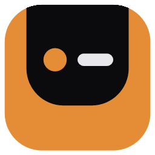
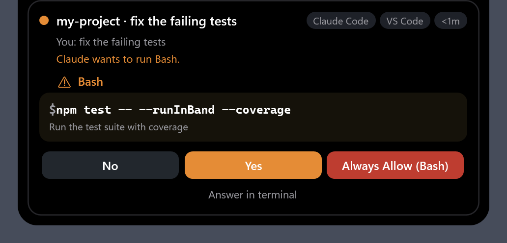
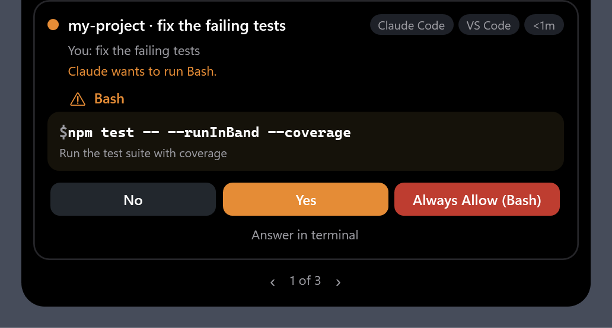
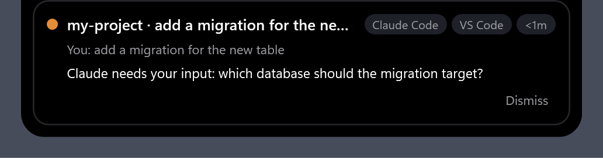
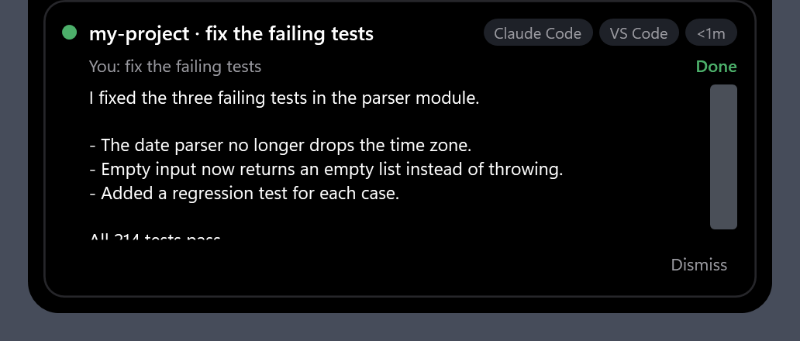
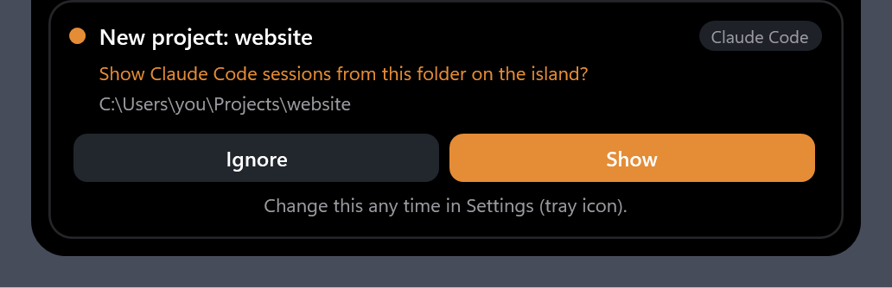
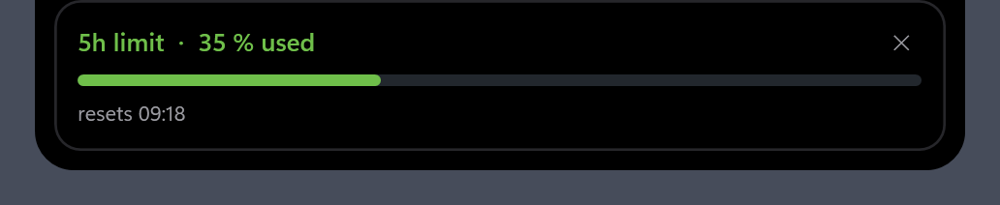
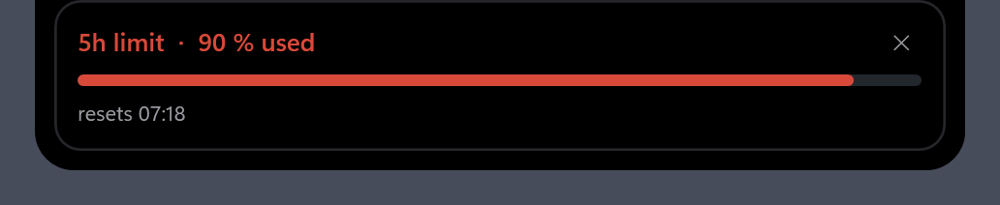

# Agent Islet for Windows




**Agent Islet**: a small black "island" that drops down from the top of your screen when your AI coding agent needs you, and gets out of the way when it doesn't. It works with Claude Code today.

Running a couple of Claude Code sessions while you do something else? You no longer have to keep checking which one is stuck waiting for you. The island tells you, and you can answer most requests right from it.

Inspired by [Open Island](https://github.com/Octane0411/open-vibe-island) for macOS. Built for Windows in C# / .NET 8 / WPF.

> Agent Islet is an independent project. It is not affiliated with, endorsed by or sponsored by Anthropic or by the Open Island project. "Claude" and "Claude Code" are trademarks of Anthropic, PBC, used here only to say what the app works with.

## What it looks like

<p>
  
  
</p>

When nothing needs you, a thin bar at the top shows your usage. Rest the pointer on it (or wait until the numbers change) and it opens:

<p>
  
  &nbsp;&nbsp;
  
</p>

<p>
  
  
  
</p>

<p>
  
  
</p>

These are drawn by the app itself from demo data (`scripts\make-screenshots.ps1`), so they always match the real look.

## What it shows

- **Permission requests.** "Claude wants to run Bash: `npm test`". Answer **No**, **Yes** or **Always Allow** from the island, or leave it and answer in your terminal or VS Code as usual.
- **Waiting for you.** When a session asks a question or sits idle waiting for input.
- **Finished.** A short summary when a turn ends (it hides itself after a few seconds).
- **Usage.** Your 5-hour and 7-day limits, plus a popup every 5 % (opt-in, see Privacy). A thin bar at the top of the screen shows one gauge per limit; rest the pointer on it to read the numbers, or wait: they drop down for a few seconds whenever they change. Turn it on, and choose "thin bar" or "only when the numbers change", in the panel's Usage tab.
- **Several sessions at once.** Cards from every session queue up ("1 of 3"), urgent ones first, labelled by project folder.

The island never takes keyboard focus, so it won't interrupt what you're typing. A waiting card stays open for 20 seconds (8 after the pointer leaves it), then shrinks to a small black pill with a count; hover over it or click it to open it again. The request itself is never dropped by that: it waits until you answer it or Claude Code moves on.

**Control panel.** Click the tray icon for a dark panel in the same style: every session and its status (answer waiting requests there too), the projects you chose to show or ignore, and a debug log.

## Status

Early and in active development. The island, the built-in connection to Claude Code, the control panel and usage tracking work and are tested. There is no packaged release yet: you build it from source. Claude Code is the only supported agent for now. The code keeps everything Claude Code-specific in one library, so other agents can be added later.

## Connect Claude Code

1. Start Agent Islet. It sits in the tray.
2. Click the tray icon, open the **Claude Code** tab and press **Connect Claude Code**. It tells you what it is about to change, saves a backup of Claude Code's settings file, and adds a few hooks that send Claude Code's events to the app on your own computer (a local address with a secret key). Nothing is installed or copied, and the app can live anywhere.
3. **Disconnect** on the same tab removes the hooks again. Running Claude Code sessions pick changes up on their next event.

If Agent Islet is not running, Claude Code behaves exactly as it would without it.

## For development: the install script

```powershell
powershell -File scripts\install-local.ps1               # usage tracking is switched on in the panel's Usage tab
```

This builds the island into `%LOCALAPPDATA%\AgentIslet`, connects Claude Code through the older helper program (`island-hook.exe`; the panel's "Switch to the built-in link" replaces that with the web hooks above) and starts it in the tray.

**You choose which projects show up.** The first time a session from a new folder reaches the island, it asks: *New project: my-app — Ignore / Show*. Until you answer, that project is left alone. Change your mind any time in the control panel's **Projects** tab (click the tray icon), where every project is listed with **Show**, **Ignore** and **Forget**.

To remove the hooks again: `powershell -File scripts\install-local.ps1 -Uninstall`.

## Try it

You need Windows 10 or 11 and the [.NET 8 SDK](https://dotnet.microsoft.com/download/dotnet/8.0).

```powershell
git clone git@github.com:Skepton/agent-islet-for-windows.git
cd agent-islet-for-windows
dotnet build AgentIslet.sln
dotnet test AgentIslet.sln
```

**See every card type** without Claude Code (cycles fake cards every few seconds):

```powershell
dotnet run --project src/Island.App -- --demo
```

**Send it a real (recorded) permission request** and answer it on the island:

```powershell
dotnet run --project src/Island.App -- --allow-all-projects   # terminal 1: the island (plus a debug window)
powershell -File scripts\publish-hook.ps1                # terminal 2: build the hook forwarder once
.\artifacts\hook\island-hook.exe simulate tests\fixtures\hooks\PermissionRequest.with-suggestions.json 120
```

Click a button on the island and the forwarder prints exactly what Claude Code would receive.

App flags: `--shots <folder>` (draw every view to PNG files and exit; used by `scripts\make-screenshots.ps1`), `--demo` (fake cards), `--tray` (start hidden in the tray), `--poll-usage` (turn on usage tracking and remember it in `config.json`, as the Usage tab's switch does), `--allow-all-projects` (skip the per-project question; for testing).

## How it works

```
Claude Code ──http hook──▶ local address (127.0.0.1, secret key) ──▶ island app (overlay + tray)
            ◀──decision (permission requests only)──────────────────┘
```

Claude Code calls a hook (an entry in its settings) on events like "permission requested" or "turn finished". The hook is a plain web request to the island app on your own computer, so there is no helper program to install. For a permission request the request stays open until you answer, and the answer goes back as the response. You can still answer in the terminal at any time, and the card disappears. (The older way, a small helper program talking over a named pipe, still works and is what `scripts\install-local.ps1` sets up.)

## Privacy and safety

- **Fail-open.** If the island isn't running, crashes or doesn't answer, Claude Code gets no decision from it and behaves exactly as it would without it.
- **Local only.** The app listens on the loopback address only (not your network). Its address contains a random secret key kept in `config.json`, and requests without it, or with a foreign `Host` header, are refused, so a web page or another program cannot send fake approvals. (The older pipe is restricted to your Windows user.) Prompts and commands are shown on cards and kept in memory only. Nothing from your sessions is written to disk except the folder paths of projects you chose to show or ignore.
- **Usage tracking is opt-in** (the switch in the panel's Usage tab, off by default; `config.json` in the data folder records it and when you agreed). It reads Claude Code's own sign-in token (read-only: never stored, logged or refreshed) and calls the same usage endpoint Claude Code's `/status` uses, on `api.anthropic.com` only. That endpoint is unofficial and may change.
- Connect backs up your Claude Code settings first, touches only its own entries, and Disconnect removes them cleanly. It asks before it changes anything.

## Project layout

```
src/Island.Core        agent-neutral core: sessions, card queue, local web endpoint and pipe, usage milestones
src/Island.ClaudeCode  everything Claude Code-specific (hook payloads, decisions, Connect, usage endpoint)
src/Island.Hook        island-hook.exe, the older forwarder (still works; not needed with the built-in link)
src/Island.App         the WPF island, tray icon and debug window
tests/                 xUnit tests against real, sanitised Claude Code payloads
```

To support another agent, add an `Island.<Agent>` library that implements `IAgentIntegration` (translate its hook payloads into neutral events, encode answers into its hook output) and register it in the app. See [PLAN.md](PLAN.md) §4.1.

More detail: [PLAN.md](PLAN.md) (architecture and roadmap), [docs/findings.md](docs/findings.md) (verified Claude Code behaviour), [docs/design.md](docs/design.md) (the look).

## Licence

Licensed under the GNU General Public License v3.0 (see [LICENSE](LICENSE)), the same licence as Open Island, the macOS app whose look inspired this one. No code, design files or brand assets were copied from it.
